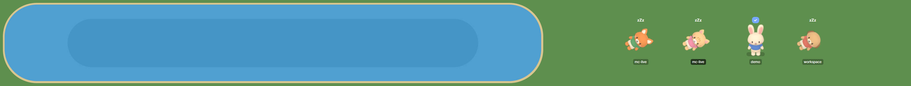

# Gilbak Office

A strip of grass with a pond, where every coding agent is a small 3D animal from the game Gilbak Village (길밖의 마을): a rabbit, a dog, a fox or a cat. Working agents swim in the pond. Agents that need you stand on the shore with a `!` or a `✓` over their head. Idle ones stand still at their own place and lie down to sleep after five minutes. Click one to go to its agent.

## What you see

A panel that fills whatever block it is given (first docked at the bottom, 240px tall). Grass `#5f8f4e` everywhere, 8px of margin inside the edges.

- **Pond.** In a panel at least 1.4 times wider than tall it takes the left 60% of the floor, the shore the right 40%, 8px between them. In a taller panel the pond takes the top 60% and the shore the bottom 40%. Three stacked rounded rectangles: a sand rim `#d9c58f` (corner radius 42% of the shorter side), the water `#4f9fd0` inset 5px (radius 40%), and a deeper middle `#3f8cc0` at 55% opacity covering the middle 76% × 60% (radius 30%).
- **Shore.** One place per agent, in agent order, in rows centered on the shore. A place is 62 × 84px at scale 1; columns spread to at most 1.6 times that, rows to at most 1.2 times.
- **Animal.** 72 × 72px at scale 1. Under it on land, a shadow: a `#00000030` ellipse 44% of its width, 7px tall. The whole scene's scale is the largest of 1.6, 1.5, … 0.5 at which every agent has a place on the shore.
- **Name tag**, centered 8px under the feet (20px under the body while swimming): 10px white text on `#00000048`, 4px corners, cut with an ellipsis at the animal's width + 48px. It shows the tab's name if someone named it, else the space's name. The focused agent's tag and the hovered one have a `#000000a0` background; the hovered one adds ` · ` and the program's name ("Claude Code").
- **No agents**: "No agents yet." (Korean "아직 에이전트가 없어요." on a Korean system) in `#ffffffc0`, 12px, centered on the shore.

## How it behaves

- **working**: the animal walks to the nearest edge of the pond, then swims: lying flat, paddling, with a white ellipse under it (88% of its width, 22px tall) pulsing between 18% and 42% opacity every 1100ms. It swims to a random spot in the pond, stays 0.6 to 3 seconds, and picks another. Swimming is 38px a second, walking 70px a second, both times the scale.
- **blocked**: it swims to the edge nearest its place, walks there, and stands with a `!` in a pill of the theme's `blocked` color over its head, pulsing between 60% and 100% opacity every 900ms.
- **done**: the same, with a `✓` in a pill of the theme's `done` color, not pulsing.
- **idle**: it stands still at its place, breathing (the idle clip). Nothing else moves.
- **idle for more than 5 minutes**: it lies down at its place, with `z`, `zZ`, `zZz`, `zZ` in white bold over it, one every 700ms. An agent whose tab has not changed since the app started is asleep from the start.
- **Which animal**: a hash of the agent's pane id picks one of the four, so an agent keeps its animal across restarts. More than four agents share animals.
- **Facing**: walks and swims use one of four diagonal clips, chosen by the direction of the leg (down-right when it goes straight right or straight down).
- **Order**: animals are drawn back to front by where they stand.
- **Click**: focuses the agent's pane (`pane.focus`), or the agent itself when it has no pane (`agent.focus`).
- **Hover**: the tag shows the program's name.
- **Agents come and go**: a new one appears at its place (in the pond if it is working); the others walk to their new places.
- **Resizing**: the pond, the places and the scale are worked out again and everyone walks or swims to where they now belong.

## Built from

- A mod only: `mods/herdr-office/`. `mod.json`: `{ "place": "bottom", "size": 240, "title": "Office" }`. No layout, no keys.
- `main.js`: the `View`. One `cx.timer.every(500)` that calls `cx.notify()` only when an animal starts or ends a leg, changes mood, or an agent comes or goes. Each animal is an absolutely placed `div` with `.transition("left", { duration, easing: "linear" })` and the same for `"top"`, so the motion itself is native. The clip is an `image(...)` of an animated WebP, which plays by itself. The pulse is `.loop("opacity", ...)`, the snore `.frames([...], 700)`.
- `office.js`: pure, no Herdr imports. `speciesOf(agent)`, `moodOf(status, since, now)`, `plan(width, height, count)` (scale, pond, shore, one place per agent, the rectangle swimmers stay in), `step(walker, mood, home, layout, now, rand)` (plans one straight leg at a time; a leg is a swim when both its ends are in the water), `spawn(...)`, `clipOf(walker)`, `posOf(walker, now)`.
- `herdr` functions: `agents`, `spaces` (for tab names and `changed_at`), `theme` (`blocked`, `done`), `run`. Commands: `pane.focus {pane}`, `agent.focus {terminal}`.
- Programs it runs: none. No `exec`, no `hc`, no `fetch`, no files read or written.
- Art, in `mods/herdr-office/art/<rabbit|dog|fox|cat>/`: ten WebPs each, 96 × 96px. `walkSE`, `walkSW`, `walkNE`, `walkNW` (8 frames, 10 fps), `swimSE`, `swimSW`, `swimNE`, `swimNW` (8 frames, 8 fps), `idle` (4 frames, 4 fps, facing the viewer), `sleep` (one still frame: the idle pose turned 63° clockwise). In a frame the feet are at (48, 82.6); shown at 72px that is (36, 62), and the middle of a swimming body is at y 46.
- The art was rendered in Blender from the Gilbak Village character models as 128px sheets (rows are the eight directions, columns the frames) and cut by `tools/build_sprites.py` (Python, Pillow): `python tools/build_sprites.py <sheets folder> <art folder>`. The swim clips are the sheets' `dive` action.
- Tests (plain node, outside the mod folder): `npm test`, 11 tests.

## Watch out

- **Never step frames from a timer.** Swapping `image()` paths every 100ms redraws the whole window each time and loads hundreds of files; a mod that uses too much memory stops rendering. Let the animated WebP play and let `transition` move it.
- GIF has one-bit transparency, which leaves a jagged rim on smooth 3D renders. Use animated WebP, saved lossless.
- **Place nobody before the first size report.** The view starts with no size; placing animals for a guessed size makes them all walk to their real places as soon as the panel is measured.
- A leg's clip is fixed for the whole leg, so getting in and out of the pond is two legs: walk to the edge, then swim. Otherwise an animal swims across the grass.
- Keep swimmers in a rectangle inset from the pond's edge (half an animal's width at the sides, the body's height at the top, 12px at the bottom), or they paddle over the sand rim.
- The sheets' `swim` action is an upright paddle that only reads as swimming with the lower body cut off. The `dive` action lies flat and needs no cutting.
- Animated WebP only plays in Herdr; `herdr-app shot` shows whichever frame was last drawn.
- The sleep timer counts from when the mod first saw the status change. Right after the mod loads it uses the tab's `changed_at` instead, so an agent that has been idle for an hour in a tab where another agent just changed stands for five minutes before lying down.
- Four animals only: with five or more agents some look alike, and the name tag is what tells them apart.
- Sub-agents are not shown: `agents()` lists them only when they have their own status, and nothing ties one to its parent here.
- Tested on Windows with Herdr app 0.1.15. Not checked: agents on another machine, more than four agents on screen, hours of running.

## Done when

- `herdr-app check mods/herdr-office` passes and `npm test` reports 11 passing.
- With agents in several tabs, each has its own animal on the shore with its name under it, and no two stand in the same place.
- When an agent starts working, its animal walks to the pond and swims from spot to spot without leaving the water.
- When it finishes, the animal swims to the edge, walks back to its place and shows `✓`; looking at the agent removes the mark.
- An agent waiting on an approval stands on the shore under a pulsing `!`.
- An idle agent does not move; five minutes later it is lying down under `zZz`.
- Clicking an animal focuses its agent's pane.
- Dragging the panel taller or narrower moves the pond and the places, and everyone ends up inside the panel.
